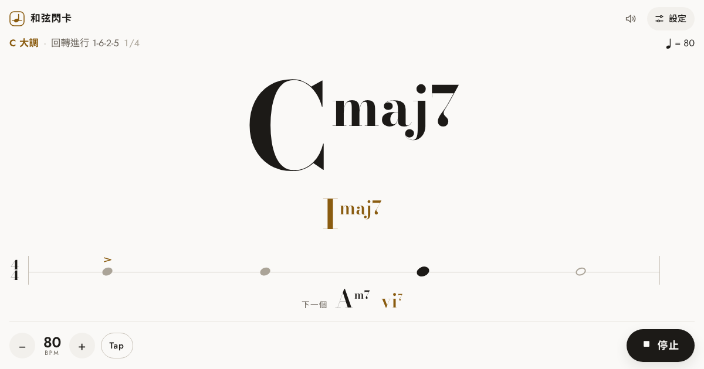

# 和弦閃卡

按拍子閃現和弦的練習工具。設定速度和拍號後，和弦會隨節拍逐個出現。可以只顯示級數，並選用羅馬數字或阿拉伯數字。

**網站：** https://sleet-ling.github.io/chord-flash/

## 功能

- **節拍**：速度 30–260 BPM；拍號 4/4、3/4、2/4、6/8；每個和弦維持半小節至 8 小節；可加預備小節，亦可用 Tap 設定速度
- **顯示**：和弦名稱、只顯示級數或兩者並列；級數可用羅馬數字（ii–V–I）或阿拉伯數字（2m–5–1）
- **調內和弦**：選調和級數，三和弦、七和弦或混合，隨機或順序出現
- **隨機和弦**：自選根音和和弦類型，分初級、中級、進階
- **和弦進行**：卡農、王道進行、丸之內進行、小室進行、2-5-1、十二小節藍調等，亦可自訂
- **轉位**：可加入 slash chord（例如 G/B）
- **節拍器音色**：電子、嗶聲、機械、木魚、響棒、牛鈴、鼓組，在設定點選即可試聽
- **介面**：跟隨系統、淺色或深色
- 設定會自動儲存在瀏覽器；播放時會盡量保持螢幕不熄

## 自訂進行寫法

| 寫法 | 例子 | C 大調結果 |
|---|---|---|
| 阿拉伯數字，小和弦加 m | `1 5 6m 4` | C G Am F |
| 羅馬數字，大小楷分大小和弦 | `I V vi IV` | C G Am F |
| 降半音加 b | `b7`、`bVII` | B♭ |
| 斜線後是低音 | `5/7`、`V/VII` | G/B |
| 七和弦及其他類型 | `2m7 57 1maj7` | Dm7 G7 Cmaj7 |

和弦之間用空格或 `-` 分隔。

## 鍵盤快捷鍵

| 按鍵 | 作用 |
|---|---|
| 空白鍵 | 開始／停止 |
| ↑ ↓ | 速度加減 1 |
| Shift + ↑ ↓ | 速度加減 10 |
| T | Tap 設定速度 |

## 技術

整個網站只有一個 HTML 檔案，毋須安裝或建置。節拍器用 Web Audio API 預先排程，以音訊時鐘計時，長時間播放亦不會漂移。

構思參考 [Flash Chord](https://www.flashchord.com)。
